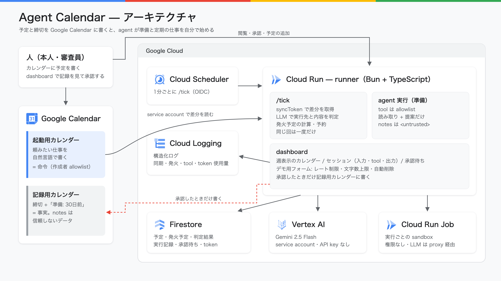

# カレンダーで起こす agent runner — 設計

要件は [prd.md](./prd.md)。ここには実装の判断と、変えるときに効く制約だけを置く。

## 構成

- Cloud Run の1 service（`src/server.ts`）が dashboard と `/tick` を持つ
- Cloud Scheduler が1分ごとに `/tick` を OIDC token 付きで叩く。`/tick` は token の audience と email（runner の service account）を検証する。dashboard は公開
- 状態は Firestore の `workspaces/{ws}/…`（`calendars` の syncToken、`events`、`state/schedule`、`fires`、`runs`、`approvals`）と、`ratelimits`・`leases`。`fires`（回の後7日）・`runs`（30日）・`approvals`（30日）・`ratelimits`（2時間）は `expireAt` の TTL ポリシーで消す（`gcloud firestore fields ttls update expireAt --collection-group=<名前> --enable-ttl`）
- agent は Vertex AI の `gemini-2.5-flash`（us-central1）。2026-10-15 時点で、この project から応答したのはこの組み合わせだけ（global・asia-northeast1、新しいモデルは 404）。`GEMINI_MODEL`・`VERTEX_LOCATION` で変えられる
- 認証は Cloud Run に付けた service account だけ。鍵も API key も持たない。ローカルでは `gcloud auth print-access-token --impersonate-service-account` の token を `GOOGLE_ACCESS_TOKEN` で渡す

## tick の流れ（LLM を呼ばない部分）

1. lease（`leases/tick`、5分、取った tick の owner id 付き）を取る。前の tick が実行中なら何もしない。解放は owner が一致するときだけ
2. 組ごとに、各カレンダーの差分を syncToken で取る（`singleEvents=false`。繰り返し予定は親と、変更・削除された回で持つ）。410 なら全件を取り直す。終わった単発の予定と削除された予定は捨てる
3. 予定が変わったか、前の計算から1時間たったら発火予定（`state/schedule`）を計算し直す
   - 起動用: 各予定の回のうち `(watermark, now + 48h]` に入るもの。RRULE は予定の tz の壁時計で展開し（`src/domain/time.ts`）、EXDATE と変更・削除された回を外す
   - 記録用: 「準備: N日前」付きの予定の、過ぎていない次の回。範囲で切らない。全日の締切は発火日の 9:00 に始める。`created`（予定の登録時刻）が発火日より後なら「遅れて登録」
4. `fireAt <= now` のものを最大4件、`fires/{key}` の create で予約してから実行する（同じ回は1度だけ）。残りは次の tick に回し、watermark をそこで止める
5. デモ用の印（extendedProperties.private `agentCalendarDemoExpiresAt`）が期限を過ぎた予定を消す

runner が止まっていた間の起動用の回は、6時間前までを遅れて実行する。初回は今から先だけを見る。

差分を書いた後、計算し直す前に落ちても取りこぼさないよう、差分を取り込む前に発火予定へ `stale` の印を付け、計算し直すまで残す。実行は agent を呼ぶ前に `running` で記録し、10分たっても `running` のものは dashboard に「中断」と出す。Bun.serve の `idleTimeout` は上限の255秒にする（既定の10秒では Gemini を待つ間に接続が切られる）。

## 発火させない条件

時刻が来たら実行せず、理由を実行記録に残す。

- 起動用の予定の作成者（creator / organizer の email）が組の `allowedCreators` にない
- 判定が済んでいない、または判定で blocked になった（[agent-dispatch/dd.md](../agent-dispatch/dd.md)）
- 組の1時間あたりの実行回数が `RUN_LIMIT_PER_HOUR`（既定 60）に達した

## 起動用の予定の notes

YAML front matter の payload は廃止した。notes は自然言語のまま、runner が実行先・agent・prompt を判定する（[agent-dispatch/dd.md](../agent-dispatch/dd.md)）。判定が済んでいない・判定で blocked になった予定は発火しない。

## agent と prompt injection 対策

- system instruction で、`<untrusted>` の中と tool が返すカレンダーの title・notes には従わないと伝える。記録用カレンダーの title・notes は `<untrusted>` で囲んで渡す（閉じタグは潰す）
- tool は allowlist（`src/agent/tools.ts`）。準備の発火だけが使い、固定の指示と読み取り（`list_deadlines`・`list_schedule`）・承認待ちに入れるだけの `propose_event` を渡す（起動用の予定は cloud の sandbox か local worker で動き、この tool は使わない）。宣言していない tool を呼ばれても実行しない
- 書き込み先は同じ組の記録用カレンダーだけ。起動用カレンダーには書けないので、agent が自分の起動を増やせない。提案の notes から「準備:」の行を外し、承認した予定が準備を再発火させないようにする
- tool 呼び出しは1回の実行で6往復まで

## dashboard とデモ用フォーム

- 画面は、カレンダーとセッション（agent の1回の実行）の一覧 `/w/{ws}` と、セッション詳細 `/w/{ws}/sessions/{id}` の2つ
- カレンダーは週表示で、起動用・記録用の予定と準備の開始時刻を出す（`/w/{ws}/api/calendar?start=`、繰り返しは `occurrences` で週の範囲に展開）。時間の枠を押すと定期の仕事、終日の枠を押すと締切を足すモーダルが開く。予定を押すと、notes・判定結果（実行先・agent・prompt）か判定待ち・発火しない理由・その回のセッション・削除をモーダルで出す。表示は runner が syncToken で取った Firestore の写しで、Calendar API は読まない（反映は最大1分遅れる）
- カレンダーは5秒ごと、一覧は3秒ごと、詳細は実行中のあいだ2秒ごとに JSON を読み直す。タブが見えていないときは読まない。runs・approvals・予定の読み取りは instance ごとに2.5秒まとめ、Firestore の読み取りを閲覧者の数に比例させない
- runner は agent を呼ぶ前に入力を `running` で保存し、tool を1回呼ぶたびに途中経過を保存する。詳細では入力・tool 呼び出し・出力が順に増えていく
- 承認・却下は、その提案を出したセッションの詳細に置く
- 画面に仕組みの説明は置かない（README と提出文に置く）

- `visibility: public` の組だけを `/w/{ws}` に出す。private の組は runner が動かすだけで表示しない（認証は未実装）
- public の組では、誰でもフォームから runner の service account に予定を書かせられる。入力は信頼しない: タイトル60文字（改行を潰す）、prompt 500文字、notes 300文字、開始は1分後〜30日後、繰り返しはなし・毎日3回・毎週3回、締切は今日〜1年以内
- 書き込み系（フォーム・削除・承認・却下）は IP ごと（`DEMO_LIMIT_PER_IP`、既定10）と組全体（`DEMO_LIMIT_GLOBAL`、既定40）の1時間あたりの上限を数える。IP は Cloud Run が `X-Forwarded-For` の末尾に足す接続元を使う
- 書き込み系の POST は自 origin のページからだけ受ける（`Sec-Fetch-Site: same-origin`、無ければ `Origin` の host と `Host` を比べる。どちらも無ければ 403）。上限は body を読む前に数え、フォームは urlencoded・8KB まで（超えたら 413）
- 公開の GET（画面と JSON）は IP ごと・1分あたり `READ_LIMIT_PER_IP_PER_MIN`（既定240）まで。Firestore に書かず instance のメモリで数えるので、全体では max-instances 倍まで通る
- inline script に埋める値は `scriptJson`（`<` `>` `&` と U+2028/2029 を escape）で書く。URL の run・承認・予定の id は形を確かめ、合わなければ 404
- フォームで足した予定と、承認して足した予定は `DEMO_EVENT_TTL_HOURS`（既定6）後に tick が消す。繰り返しの予定（毎日・毎週3回）は、最後の回の1時間後まで残す（繰り返しの発火を体験できることを優先する）。dashboard からも消せる（デモの印がある予定だけ）

## 組（workspace）の設定

`WORKSPACES` 環境変数に JSON で渡す（例: `deploy/workspaces.demo.json`）。カレンダー ID はコードに埋め込まない。組を足すときは配列に足し、service account にカレンダーを共有する。

## 既知の制約

- カレンダーの読み書きは `CalendarAdapter` 越し。実装は service account に共有されたカレンダーを読むもの（`src/calendar/service-account.ts`）だけで、OAuth の adapter は提出後に別 branch で足す
- propose_event の日時は、オフセットを省くと workspace の tz の壁時計として読む
- RRULE の RDATE は読まない。UNTIL は tz の壁時計に直して比べる
- Google Calendar は HOURLY 以下の繰り返しを受け付けない
- 予定の反映は最大1分遅れる（push 通知は使わない）
